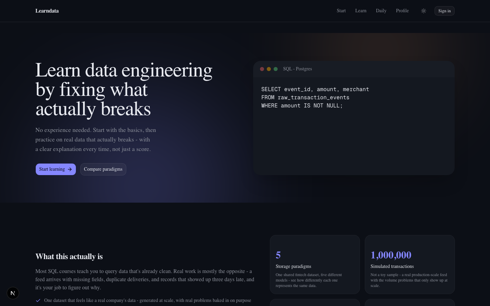
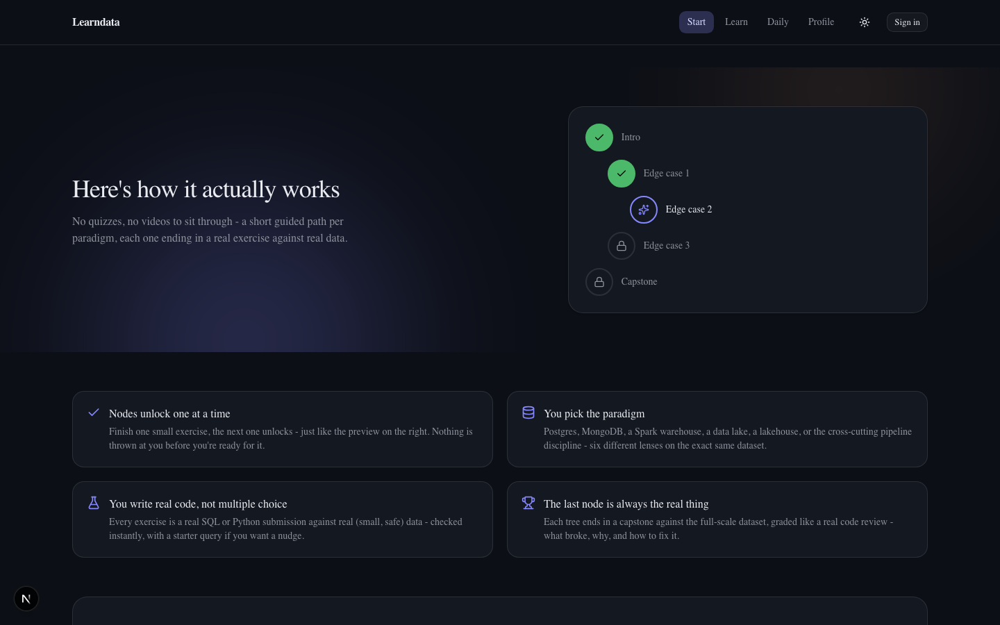
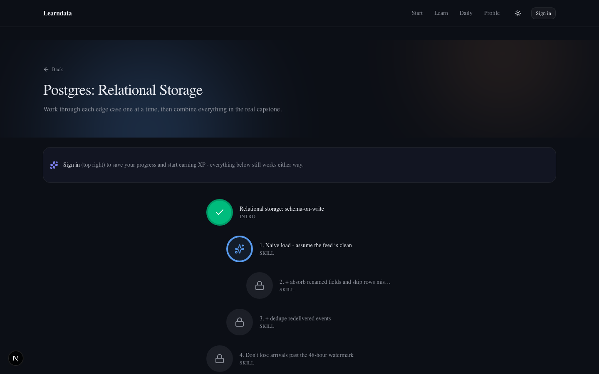
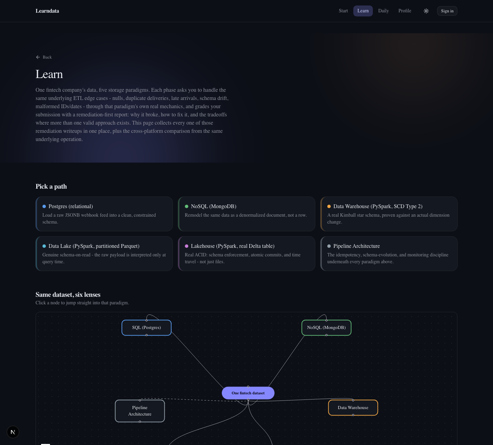

# Learndata

A hands-on platform for learning data engineering by fixing things that actually break.

One simulated fintech dataset (transactions, accounts, reward events - about a million rows),
pushed through six different storage paradigms: Postgres, MongoDB, a Spark-based data warehouse,
a data lake, a lakehouse, and a cross-cutting "pipeline architecture" track. Each one has real
injected ETL problems - duplicate webhook deliveries, missing fields, late-arriving records, schema
drift - and you have to find and fix them. Submissions get graded with an actual explanation of
what broke and why, not just a pass/fail.

I built this mostly to get properly hands-on with the differences between these storage models.
Reading about star schemas or the Delta Lake transaction log is one thing; writing real SQL/PySpark
against a few hundred thousand messy rows and watching a grader explain exactly which rows you
missed, and why, is a different kind of learning.

## What it looks like



A short animated walkthrough of how the skill tree works before you pick a paradigm:



A guided path through each paradigm - small fundamentals exercises first, then the real capstone
on the full dataset:



Every paradigm walks the same dataset, so Learn doubles as a cross-paradigm comparison - a real
graph, plus the same operation solved six different ways:



## What's actually running under the hood

- Five real storage engines, not mocks: Postgres, MongoDB, and PySpark against Delta Lake tables
  for the warehouse/lake/lakehouse paradigms.
- A rule-based grading engine with a real remediation catalog - every injected fault has a documented
  root cause, fix, and the tradeoffs between valid fixes.
- Per-user progress, XP, streaks, badges, and a daily SQL + Python challenge, behind Google sign-in.
- A cross-paradigm comparison graph (`@xyflow/react`) on the Learn page, showing the same
  operation solved six different ways.

**Stack:** FastAPI + Postgres + MongoDB + PySpark/Delta on the backend; Next.js 16, React 19, and
Tailwind on the frontend; Auth.js for sign-in.

## Running it locally

**One command, from the repo root:**

```
./start.sh
```

This starts the databases (Docker), the backend, and the frontend - each only if it isn't already
running - and prints the URLs once everything is healthy. Logs go to `logs/backend.log` and
`logs/frontend.log`. Run `./stop.sh` to stop the backend/frontend (the databases are cheap to leave
running; `./stop.sh --all` also stops them).

There's no single process underneath this - it's genuinely three separate things (two Docker
containers, a Python process, a Node process), which `start.sh` just launches and health-checks in
sequence. The manual, step-by-step version, if you want to run or watch any piece individually:

```
./setup.sh                                            # databases + Python venv
cd backend && source .venv/bin/activate && python -m app.main   # backend, foreground
```

Then `curl http://localhost:8000/health` should return `{"status":"ok","database":"reachable"}`.
Host/port come from `.env` (`API_PORT`), not hardcoded.

Note: Postgres runs on host port **5433**, not 5432 - deliberately, to avoid colliding with a
native/Homebrew Postgres install that might already be running on the default port. MongoDB runs
on the default **27017**.

Frontend (separate terminal, with the backend already running):

```
cd frontend
npm install
npm run dev
```

Then open `http://localhost:3000`. It talks to the backend at `NEXT_PUBLIC_API_BASE_URL` (defaults
to `http://localhost:8000` - see `frontend/.env.local.example`).

Running PySpark locally also needs a JDK - see `backend/app/core/config.py` for the
`spark_java_home` setting if your machine doesn't have one on the default path.
